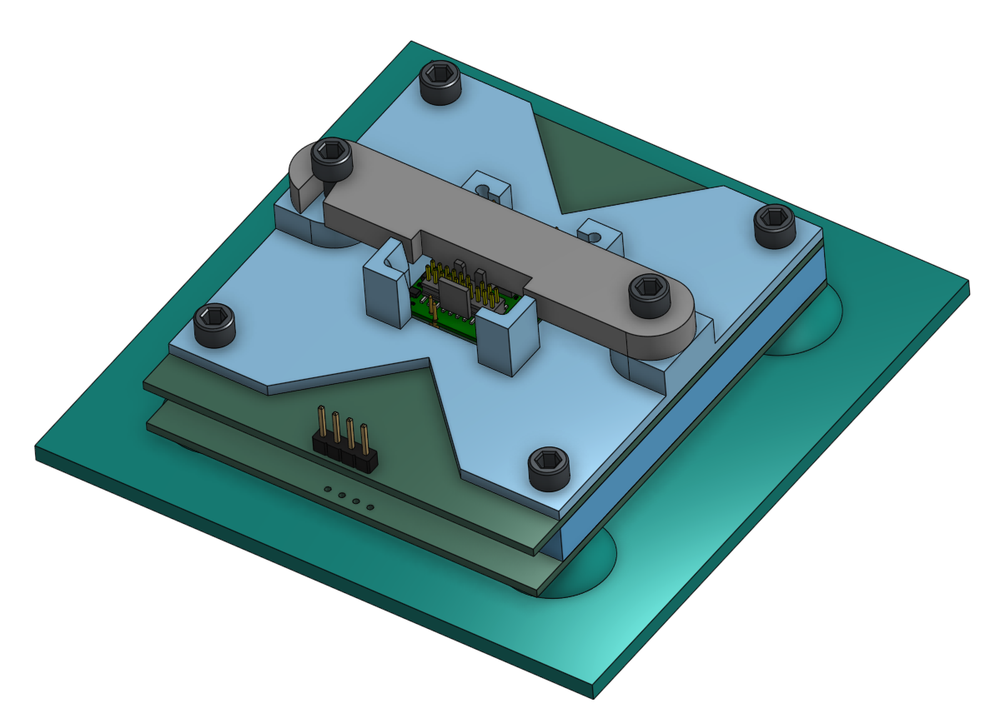

# nRF9151-MK-BG95 interposer programmer

A pogo-pin jig that gives the PCA10196 BG95 interposer (an nRF9151 on a BG95 footprint) power
and a UART AT interface, so the Serial Modem firmware and modem firmware can be programmed and
tested without soldering. SWD is connected with a separate cable.



## Contents

| Folder | What it holds |
|---|---|
| `pcb/` | KiCad project of the pogo-pin plate (`bg95-pogo-plate`), BOM, gerbers in `production/`, and local footprints, 3D models in `lib/` |
| `3d-model/` | 3D-printed frame parts (`.3mf/.step`) and `Assembly.png` |
| `fw/bg95_programmer_at_interface/` | nRF54LM20 DK app: AT shell that forwards typed lines to the interposer |
| `fw/flash_and_verify.py` | Programs modem firmware and app, then checks AT and the modem version |
| `fw/*.hex`, `fw/*.zip` | Serial Modem v2.0.0 release image and modem firmware `mfw_nrf91x1_2.0.4` |

## How it works

Six spring probes land on the BG95 footprint pads of the interposer. The same PCB is used as
upper and lower plate to keep the probes aligned. Receptacles are only soldered into the upper one.

| Header J2 | Signal | BG95 pad | DK pin |
|---|---|---|---|
| 1 | VDD | 32/33 and 52/53 (VBAT_BB, VBAT_RF) | 3.0 V to 5.5 V supply |
| 2 | GND | GND pads | GND |
| 3 | DBG_TX | 23 (interposer TX, P0.15) | P1.04 (UART21 RX) |
| 4 | DBG_RX | 22 (interposer RX, P0.14) | P1.03 (UART21 TX) |

* Supply voltage: **3.0 V to 5.5 V**.
* UART: 115200 8N1, no flow control. The interposer uses 1.8 V I/O, so set the DK's `VDD_IO` to
  **1.8 V**.
* Pads 22 and 23 are adjacent, so their probes are staggered.

## Programming

Hardware: an nRF54LM20 DK running `fw/bg95_programmer_at_interface`, wired to the jig as above.
The DK's on-board debugger is routed out through its debug-out header, with a cable to the
interposer's SWD connector, and programs the nRF9151.

### SWD cable

A custom cable connects the DK's 10-pin debug-out connector to the interposer's 20-pin SWD
connector:

* The 10-pin end plugs into the DK debug-out connector. The 20-pin end plugs into the interposer.
* Pin 1 is pin 1 on both ends, and pins 1 to 10 are wired one-to-one.
* Pins 11 to 20 of the 20-pin connector are left unconnected.

### Flashing

```bash
uv run fw/flash_and_verify.py \
    --port /dev/cu.usbmodem<DK serial>3 \
    --app fw/serial_modem_v2.0.0_interposer_nrf9151_mk_bg95_nrf91m1.hex \
    --modem-fw fw/mfw_nrf91x1_2.0.4.zip
```

The script recovers the device (erases flash and UICR), programs the modem firmware and then the
app, resets, and checks that `AT` returns `OK` and `AT+CGMR` reports the expected modem firmware.
`--sn` is only needed if more than one J-Link is connected. `--port` is the DK's VCOM port.
